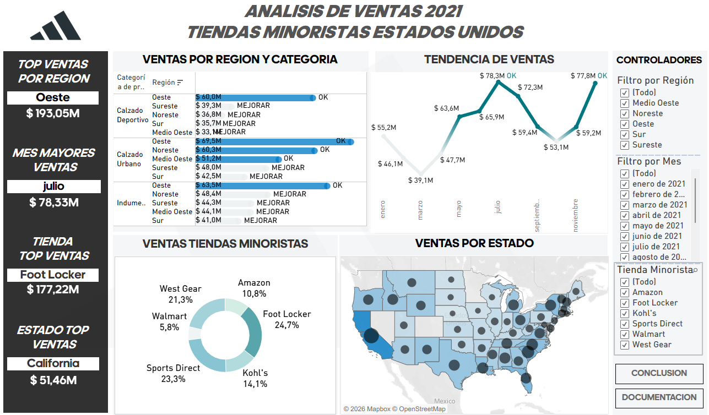
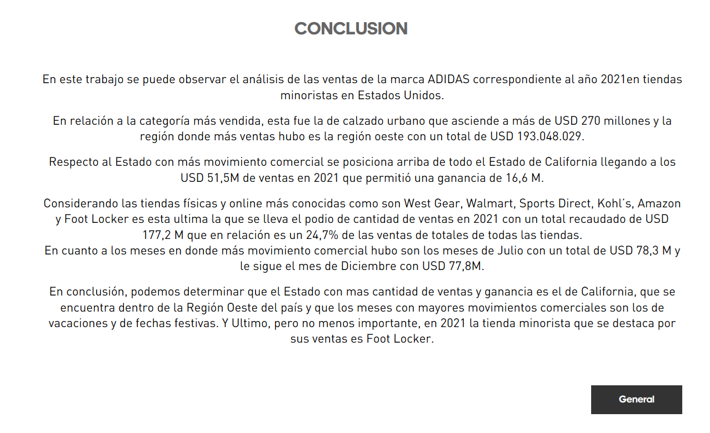

# 👟 Dashboard de Ventas Adidas (Tableau)

Dashboard interactivo del análisis de ventas de Adidas en tiendas minoristas de Estados Unidos durante 2021, por región, estado, tienda y categoría de producto.

**Trabajo final del curso de Tableau — CoderHouse.**

## 🔗 Ver el dashboard interactivo
[Abrir en Tableau Public](https://public.tableau.com/app/profile/carla.magui.a/viz/EntregaFinal_Maguia/Documentacin#1)

## 🎯 Objetivo
Identificar dónde, cuándo y a través de qué tiendas se concentran las ventas, para apoyar decisiones comerciales (distribución, promociones y foco regional).

## 📊 Vista previa

## 🔍 Hallazgos principales
- **Región líder:** Oeste, con USD 193,05 M en ventas.
- **Estado líder:** California, con USD 51,46 M.
- **Categoría más vendida:** calzado urbano (más de USD 270 M).
- **Tienda líder:** Foot Locker, con USD 177,22 M (24,7 % del total).
- **Estacionalidad:** julio (USD 78,3 M) y diciembre (USD 77,8 M) son los meses de mayor venta: vacaciones y fechas festivas.

## 🛠️ Herramientas
- Tableau (dashboard interactivo con filtros por región, mes y tienda)
- Excel (datos de origen)

## 📁 Contenido del repositorio
| Archivo | Descripción |
|---|---|
| `Entrega Final_Maguiña.twbx` | Libro de Tableau con el dashboard |
| `AdidasSalesdata.xlsx` | Dataset utilizado |
| `Dashboard.png`, `conclusion.png`, `tabla.png` | Capturas del trabajo |

## 📂 Datos
Dataset público de ventas de Adidas, obtenido de **Kaggle**. Se usa con fines educativos.

## 👩‍💻 Autora
Carla Maguiña
